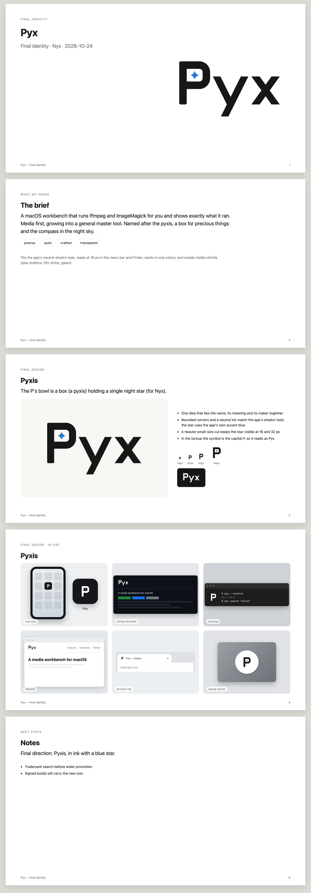

# Pyx brand

## The idea

The mark is a P whose bowl is a box holding a single star. A *pyxis* is a lidded box for
precious things, and Pyxis is also the compass constellation in the night sky (Nyx is the
night). The star is the only coloured part.

In the horizontal lockup, the symbol is the capital P, so it reads as "Pyx". The stacked
lockup puts the symbol above the lowercase `pyx` wordmark.

## Files

| Use | File |
|---|---|
| App icon (macOS, 1024px) | `png/pyx-app-icon.png`, plus `png/pyx-app-icon-small.png` for 16–32px |
| Symbol | `svg/pyx-symbol.svg` |
| Symbol under 32px | `svg/pyx-symbol-small.svg` (heavier strokes, simpler star) |
| Horizontal lockup ("Pyx") | `svg/pyx-horizontal.svg` |
| Stacked lockup | `svg/pyx-stacked.svg` |
| Wordmark only | `svg/pyx-wordmark.svg` |
| Favicon and web icons | `web/` (`favicon.svg` follows the light/dark setting) |

Every symbol, lockup and wordmark file comes in four versions:

| Suffix | Use it on |
|---|---|
| (none) | Light backgrounds, full colour |
| `-reversed` | Dark backgrounds, full colour |
| `-black` | One colour, black |
| `-white` | One colour, white |

`png/` holds a 1024px transparent PNG of every SVG.

All artwork is built from code. `marks.py` holds the geometry, and `build_kit.py` writes
the SVGs into `svg/`. After changing either, run `python3 docs/brand/build_kit.py`, then
re-export the PNGs. To refresh the app icon, run
`bun tauri icon docs/brand/png/pyx-app-icon.png`. Then rebuild `src-tauri/icons/icon.icns`
with `iconutil`, using the small-cut icon for the 16px and 32px slots. In the app, the
mark is `src/components/pyx-mark.tsx`.

## Colour

| Name | HEX | RGB | Use |
|---|---|---|---|
| Ink | `#171717` | 23 23 23 | The P and the wordmark (the app's `--primary`) |
| Pyx Blue | `#2A78D6` | 42 120 214 | The star on light backgrounds (the app's `--viz-1`) |
| Pyx Blue, dark | `#3987E5` | 57 135 229 | The star on dark backgrounds |
| Paper | `#FFFFFF` | 255 255 255 | Reversed P and wordmark |
| Night | `#2B2E35` → `#0E0F12` | | The app icon's tile, top to bottom |

Contrast:
- Ink on white: 17.9:1.
- Pyx Blue on white: 4.4:1.
- Dark blue on near-black: 5.4:1.

The star is a graphic, not text, so these all pass.

## Clear space and minimum size

**Clear space.** Keep space around the logo equal to the width of the P's stem (32 units
on the 256 grid, or 1/8 of the symbol's box). Nothing else goes inside that space.

**Minimum sizes:**

| Version | Minimum |
|---|---|
| Symbol | 16px; use the small cut from 32px down |
| Horizontal lockup | 72px wide |
| Stacked lockup | 48px wide |

## Type

The wordmark is custom-drawn and isn't a font. In the app, text is set in Geist, and the
sidebar's "Pyx" heading uses the pixel heading. Don't retype the wordmark in a font.

## Don't

- Recolour the P, or put the star in any colour other than Pyx Blue, black or white.
- Use the star without the P, or the P without the star.
- Stretch, rotate, outline or add effects to the mark. The app icon's tile gradient and
  shadow belong to the icon only.
- Place the full-colour mark on a busy photo or a mid-tone background; use the black or
  white version instead.
- Put the stacked lockup's `pyx` next to the horizontal "Pyx". Pick one lockup per layout.

## Notes

- No trademark search has been done. Run one (USPTO/EUIPO and a reverse image search)
  before promoting Pyx widely.
- The concept round is kept in `concepts/`.
